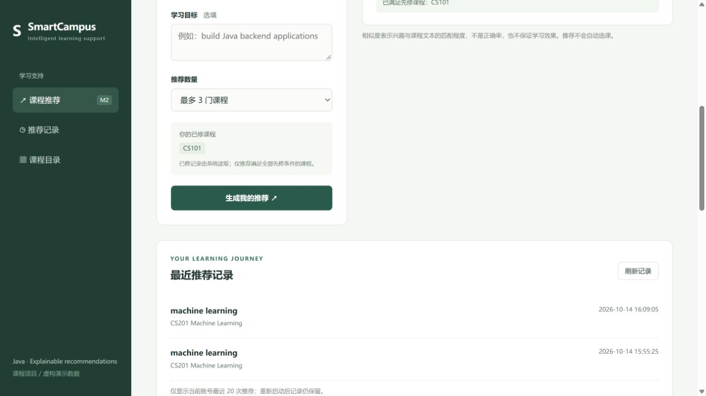

# SmartCampus · M2 课程推荐

Java/Spring Boot 实现的 CSIT883 M2 模块：根据兴趣与目标推荐最多三门课程，排除已修课程和先修不足课程，并给出匹配词与推荐理由。包含真实页面、个人历史、权限保护、演示数据库和测试。

最新 proposal 与职责表的 M2 是课程推荐；旧执行指南中的在线测验不是本次范围。后端/算法使用Java；页面为原生HTML/CSS/JS，可接入团队Vue。代码为本项目独立实现，没有复制参考校园系统的业务代码。



## 本机开始
需要 Java 17+、Maven 3.6.3+。本机已验证 Java 25、Maven 3.9.16；源码按Java17编译。前端测试需要 Node.js 18+，不安装npm依赖。

在项目文件夹打开 PowerShell：
```powershell
powershell -NoProfile -ExecutionPolicy Bypass -File .\run.ps1
```
打开 http://127.0.0.1:8082 。演示账号 `student1` / `student2`，演示密码 `demo-password`，均为合成账号。student1已修CS101；student2已修CS101、CS102、CS201。输入 `machine learning` 可看到不同资格的推荐。

默认H2文件库保存到 `data/m2.mv.db`，自动初始化20门虚构课程，无需等待团队数据库。历史重启保留，session重启后需重新登录。Ctrl+C停止。更改源代码后先停服务，再执行 `run.ps1 -Build`，然后启动。

通用跨平台命令：
```text
mvn test
node --test frontend-test.mjs
mvn package
java -jar target/smartcampus-m2-1.0.0.jar
```
Windows一键测试：`powershell -NoProfile -ExecutionPolicy Bypass -File .\run.ps1 -Test`。首次Maven需要联网；本机脚本能找到原课程目录现有Maven与缓存；其他电脑安装Maven或设置M2_MAVEN_HOME。不要将tools、target、data上传。

## 数据库完成后的接入
请先与数据库成员核对 [接口与字段契约](docs/api-and-database.md)，审核 `database` 下SQL草案，再在本地环境设置以下变量：
```powershell
$env:M2_DB_URL='jdbc:mysql://127.0.0.1:3306/smartcampus?serverTimezone=Asia/Shanghai&characterEncoding=UTF-8'
$env:M2_DB_USER='由组员提供'
# M2_DB_PASSWORD、M2_SHARED_TOKEN 使用本机环境安全配置，不写入Git。
$env:M2_SHARED_STUDENT_ID='共同用户编号'
.\run.ps1 -Profile mysql
```
mysql模式不初始化数据、不启用公开演示账号。临时Bearer身份桥只用于受控单用户联调；最终接入团队已验证的StudentIdentity。真实MySQL、全组统一登录与Vue集成尚未验证。

## 算法与评价
课程标题+描述构成语料，英文小写词元、少量停用词、平滑IDF、L2归一化后余弦排序；同分按课程编号稳定排序。资格检查先于结果输出。未知词不会被虚构成语义匹配；不调用LLM、无需API密钥。相似度不是正确率。

[评价和验证记录](docs/test-report.md) 列出20个合成档案与关键词基线、实际测试及限制；`mvn test` 重新生成 `target/evaluation-results.csv`。模拟标签未经独立专家审阅，不能外推真实学生效果，也不宣称优于基线。

## 目录
`src/main/java` 算法/身份/接口/存储；`src/main/resources/static` 页面；`db` H2样例；`src/test` Java测试及20档案；`frontend-test.mjs` 账号切换竞态测试；`database` MySQL交接SQL；`docs` 设计、接口、用例、评价与截图。

Spring Boot 3.5.3、MyBatis-Plus3.5.12是本机验证的原型构建基线；默认绑定127.0.0.1。对外部署前由团队升级依赖、接入正式认证、使用HTTPS并重新验收。本项目仓库公开源码不等于对外部署服务。

框架资料：[Spring Boot](https://docs.spring.io/spring-boot/3.5/system-requirements.html)、[MyBatis-Plus](https://baomidou.com/en/getting-started/)。
