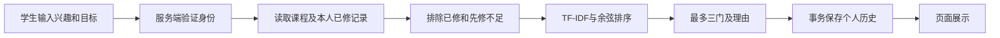

# M2 接口与数据库交接

## 接口
统一响应：`{"code":"OK","message":"Success","data":...}`。400 非法参数、401 未认证、403 CSRF 校验失败、404 不存在、500 内部错误。个人响应 `Cache-Control: no-store`。

| 方法/路径 | 输入 | data |
|---|---|---|
| POST /api/auth/login | demo 专用，username、password | studentId、csrfToken、mode |
| GET /api/auth/session | demo session cookie | 同上；刷新恢复登录 |
| POST /api/auth/logout | demo cookie 和 X-CSRF-Token | 空对象；旧 session 失效 |
| GET /api/m2/me | 服务端验证身份 | studentId、completed[]、profile{interests,goals} |
| GET /api/m2/courses | 服务端验证身份 | 生效课程数组：id/title/description/prerequisites[]/active |
| POST /api/m2/recommendations | interests 必填1–500字符，goals 0–300，topK 1–3默认3 | algorithm、query、items[]、catalogSize |
| GET /api/m2/history | 当前身份，无其他学生参数 | 最近20条：id/query/createdAt/result |

推荐项：`course`、0–1 `score`、`matchingTerms[]`、`reason`。少于三条正常，无匹配返回空数组。`studentId`、`completed` 等未知请求字段返回400；GET历史即使添加他人 studentId 也始终只查本人。

```json
{"interests":"machine learning","goals":"","topK":3}
```

demo 页面与API同源，CSRF token 仅存内存，session cookie HttpOnly、SameSite Strict。没有开放跨域。团队 Vue 同源代理 `/api/m2` 即可调用；不要启用允许所有来源的凭据跨域。

mysql 模式关闭所有 demo 登录。暂时通过环境 `M2_SHARED_TOKEN` + `M2_SHARED_STUDENT_ID` 配置一个集成测试身份；Bearer token 使用固定时间比较，不接受客户端 X-Student-Id。此桥仅用于受控联调，**不是最终全组登录系统**；不得把服务凭据写进页面或 GitHub。团队认证完成后实现 StudentIdentity.resolve(request)，从经过验证的服务端 principal 取编号；去掉临时 token bean。mysql与demo同时激活会启动失败。

## 数据职责
| 表/字段 | 所有者及含义 |
|---|---|
| m2_course(id,title,description,active) | 课程成员维护；ID稳定、描述英文、停用课程不推荐 |
| m2_prerequisite(course_id,prerequisite_id) | 全部先修要求；复合主键；禁止自依赖、未知课程及依赖环 |
| m2_completed(student_id,course_id) | 公共成绩/学习记录的完成视图；M2只读，不接受学生修改 |
| m2_profile(student_id,interests,goals) | M2维护兴趣目标，原子upsert |
| m2_history(id,student_id,query_text,results_json,created_at) | M2保存推荐快照；按学生与id索引；最近20条读取 |

学生编号与共同用户表必须统一。草案不创建用户表或公共权限表，待最终命名确定后添加FK或映射。若已有 course/completion 表，调整 CourseMapper/LearningMapper SQL及实体注解，或由数据库成员提供兼容视图；不要再建一份互相冲突的成绩库。

`database/schema-mysql.sql` 与 `database/demo-seed-mysql.sql` 是独立演示/联调草案，先在临时库执行，**尚未实测真实MySQL**。应用mysql配置 `spring.sql.init.mode=never`，启动不会建表、改表或灌入演示记录。

初始化 H2 示例会只插入缺失的课程/档案，保留推荐历史和已存在兴趣。此种子逻辑仅demo。历史和兴趣保存同一事务；同时第一次请求使用数据库原子upsert，返回结果都有历史。

## 用例与需求追踪
| 编号 | 学生操作/要求 | 实现与验证 |
|---|---|---|
| FR-M2-01 | 输入兴趣与学习目标 | Input校验、页面、ApiTest |
| FR-M2-02 | 完成条件筛选 | Recommender.eligible、RecommenderTest、EvaluationTest |
| FR-M2-03 | 最多Top3解释推荐 | Recommender.rank、匹配词、稳定排序 |
| FR-M2-04 | 个人历史与档案 | 事务、按身份查询、ApiTest/PersistenceTest |
| NFR-M2-01 | 未登录/越权保护 | StudentIdentity、ApiGuard、身份/路径/CSRF测试 |
| NFR-M2-02 | 账号切换无串数据 | 前端 generation + abort、frontend-test.mjs |

UC-M2-01 主流程：登录→读取本人已修课→输入兴趣→资格过滤→TF-IDF排序→保存兴趣与快照→返回解释。异常：未认证401、非法输入400、缺CSRF403、无匹配显示空结果、数据库失败500并回滚。



数据库成员交接时需要：MySQL连接信息、课程字段/编号、完成标准、真实共同用户编号、认证方式与Vue代理路径。随后运行真实MySQL权限/持久化/并发测试和全组页面联调。
